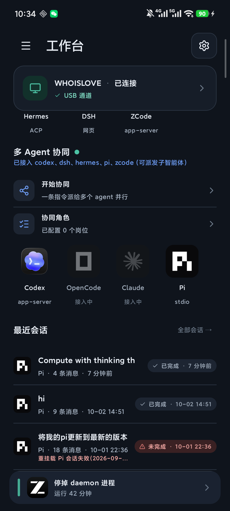
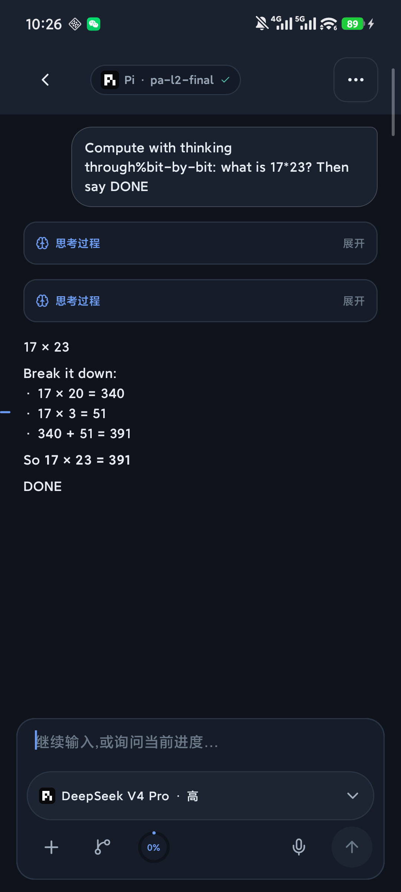
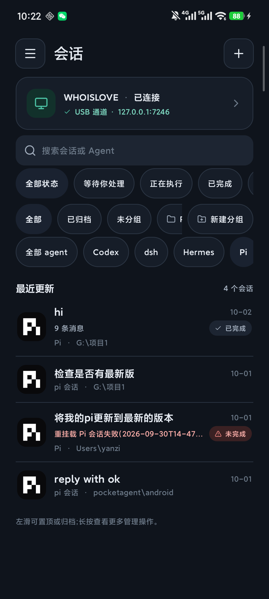
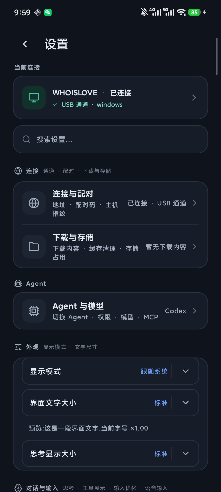

# PocketAgent — 把 AI 编程代理装进口袋 📱

> **手机只做遥控，agent 跑在你自己的电脑上，全程零云服务器。**
>
> 在手机上给电脑里的 codex / pi / zcode / dsh / hermes 发任务、看流式输出、点审批——上下班路上遥控你工作室里的 AI 编码团队。

[](#)
[](#)
[](#)
[](#)
[](LICENSE)

---

## 这是什么

**PocketAgent** 是一个"AI 编程代理遥控器"：电脑上跑着你已安装的原生 AI 编码 agent（OpenAI Codex CLI、Pi、ZCode/OpenCode、DSH、Hermes 等），手机 App 通过 gRPC/TLS 直连你电脑上的一个本地 daemon（`pocketagentd`），把它们的流式事件、工具调用、审批请求翻译成手机端体验，再把你的决定翻译回去。

**daemon 只做翻译官，不重写 agent 的循环** —— 沙箱策略、审批策略、工具权限、MCP 配置全部仍是原生 agent 自己的。没有云中继、没有账号体系、你的代码和对话永远不出你自己的电脑和手机。

### 核心特性

- 🔌 **五家 agent 原生桥接**：codex（app-server 协议）/ pi（rpc 模式）/ zcode / dsh / hermes，各家协议差异（事件形状、审批面、fork/rewind、压缩）在 daemon 侧全量适配
- 💬 **完整会话体验**：流式时间线、思考过程卡（快照可回看）、工具调用卡、代码高亮、diff 红绿、附件、斜杠命令、模型/思考强度随手切
- ✅ **审批在手机上完成**：命令执行、文件变更、补丁应用的审批卡片直达手机，危险操作分级呈现；也可留在桌面端处理（双端互认）
- 👥 **多 Agent 协同**：一条指令派给多个 agent 并行，可配置协同角色、派发子智能体
- 🖥 **电脑遥控面**：文件浏览、git 状态与暂存/丢弃、终端页（PTY 直通）、dev server 预览、控制面板（浏览器可开）
- 📴 **离线韧性**：会话离线快照、跨重启恢复、事件续传、断线降级三档通道（USB → 局域网/mDNS → Tailscale）
- 🗣 **语音输入**：端侧 SenseVoice 离线识别 或 系统语音引擎（可选）
- 🧠 **自带仓库认知索引（AOCI）**：仓库内建 1400+ 条机器治理的代码认知索引，任何 AI 助手接手开发前先读一遍，改代码不再瞎猜

## 界面预览

| 工作台 | 会话 · 思考过程 · 用量环 |
|---|---|
|  |  |

| 会话列表 · 状态刻度 | 设置 · 四入口一页 |
|---|---|
|  |  |

## 架构

```
手机 (Kotlin/Compose) ──gRPC/TLS──► 本机 daemon (Go) ──stdio JSON-RPC──► 原生 agent ──► 大模型
   遥控 / 显示 / 审批              翻译事件·中继审批·托管子进程        codex/pi/zcode/dsh/hermes
                                                                    (自有循环/沙箱/审批/MCP)
```

连通三档降级：**USB `adb reverse` → 局域网（含 mDNS 自动发现）→ Tailscale**，无云中继。

- **手机端**：Kotlin + Jetpack Compose，minSdk 26（Android 8.0+），单 Activity + Compose 导航
- **daemon**：Go 单二进制（无框架、无 ORM），gRPC + TLS，7 服务 / 93 RPC 契约（`proto/v1/`）
- **契约治理**：proto 双副本 MD5 校验、审计门禁（`tools/audit/pa_audit.py`）、Android 1839 例 + daemon 29 测试包全绿

## 快速开始

> 前提：一台 **Windows 10/11** 电脑（已安装并登录你想用的 agent CLI，如 `codex`、`pi`…），一台 **Android 8.0+** 手机，同一局域网（或 USB 线，或两端装 Tailscale）。

### ① 电脑：装桌面端 daemon

```bat
:: 源码构建（需 Go 1.27+）
cd daemon
go build -o pocketagentd.exe .\cmd\pocketagentd
```

然后以**管理员身份**运行 `dist/windows/install.bat`——它会注册看门狗计划任务（进程被杀自动拉起）、生成 **8 位配对码**（打印在日志里，重启复用不换码）。

### ② 手机：装 App 并配对

```bash
:: 源码构建 APK（需 Android SDK；中文路径请走镜像包装器）
python tools/device/_pa_gradle.py apk
adb install -r build/app-debug.apk
```

打开 App → 新建连接 → 填 `电脑IP:7246` + 8 位配对码 → 完成（TLS 证书指纹锁定，防中间人）。

### ③ 发第一条消息

工作台 → **开始新任务** → 选 agent 与工作文件夹 → 输入任务。agent 在你指定的文件夹里干活，工具调用与审批卡片实时到达手机，你点「允许 / 拒绝」。

### 日常使用

| 场景 | 做法 |
|---|---|
| 同一 WiFi | 自动 mDNS 发现，或手填 `局域网IP:7246` |
| 外网 | 两端装 [Tailscale](https://tailscale.com)，填 `100.x.x.x:7246` |
| USB 调试 | `adb reverse tcp:7246 tcp:7246`，App 填 `127.0.0.1:7246`（最快最稳） |

## 安全模型

- **零云服务器**：没有中继、没有账号、没有遥测；数据只在你自己的电脑与手机之间
- **TLS + 证书锁定**：首次连接核对主机证书指纹（TOFU），此后固定；换主机必须显式重置
- **设备公钥注册**：配对即注册手机公钥，鉴权 token 派生自配对码，不落网络明文
- **审批权在原生 agent**：daemon 只翻译不越权——沙箱模式、审批策略、白名单全部继承桌面端配置

## 从源码构建

| 部分 | 命令 |
|---|---|
| daemon 测试 | `cd daemon && go test ./...` |
| daemon 运行 | `go run ./cmd/pocketagentd -addr 0.0.0.0:7246 -workspace "你的项目目录"` |
| App APK | `python tools/device/_pa_gradle.py apk`（中文路径机器必须走此镜像包装器） |
| App 测试 | `python tools/device/_pa_gradle.py test` |
| release 签名 | 口令经 `PA_RELEASE_STORE_PASSWORD` / `PA_RELEASE_KEY_PASSWORD` 注入（`~/.gradle/gradle.properties` 或环境变量），**仓库不含任何口令** |
| 契约变更 | 改 `proto/v1/*` 后 `python tools/proto/gen_proto.py`（双副本 MD5 校验是审计红线） |

> Windows + 中文路径的构建细节、审计门禁、真机验收流程见 **[DEVELOPING.md](DEVELOPING.md)**。

## 文档导航

| 文档 | 内容 |
|---|---|
| [DEVELOPING.md](DEVELOPING.md) | 开发协作者上下文：模块地图、真值锚点、红线、坑库 |
| [QUICKSTART.md](QUICKSTART.md) | 五分钟上手：装桌面端 → 记配对码 → 手机配对 → 发第一条消息 |
| [CHANGELOG.md](CHANGELOG.md) | 版本历史（双端同版，仅维护最新版）与发版流程 |
| [AGENTS.md](AGENTS.md) | AI 协作者入口（命令/环境/红线速查） |
| [AUDIT.md](AUDIT.md) | 改动合入审核标准（甲乙丙丁分级 / L0–L2 / 红线） |
| `docs/verify/` | 每一轮真机验收与整改的证据档案（截图/日志/报告） |

## 状态与路线图

- ✅ 已达成：五家 agent 真轮真机验收、pi 思考链真机验证、离线快照与事件续传、分发级 release 签名、仓库认知索引（AOCI）1400+ 条
- 🚧 进行中：语音输入真机补验、codex 桌面账号态适配收尾
- 💡 设想中：iOS 端、桌面端 macOS/Linux、插件化 agent 适配器

## License

[MIT](LICENSE) —— 随便用，署名随意，风险自负。
